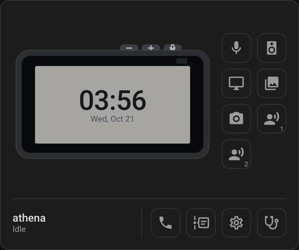

# EchoLocal for Home Assistant

  

[![hacs][hacs-badge]][hacs] 

An optional companion to [EchoLocal](https://github.com/ygelfand/echolocal), which turns Amazon Echo
Dots and Echo Shows into Home Assistant voice satellites.

EchoLocal speaks the ESPHome native API, so Home Assistant already adopts each device and gives it
an assist satellite and an entity for every setting, without this integration. This adds:

- **A card** for each device, with its settings and controls
- **A dashboard** in the sidebar with every device, plus wake words, tones, turn history, groups
  and health
- **Features the ESPHome protocol can't express**: the wake word library, custom tones and turn
  recordings
- **Calls from a dashboard** to an Echo Show, with audio or video

## The card

Drawn like the device: a Dot with its ring and light level, or a Show with its screen. Buttons for
the microphone, playback, ring, screen, posters, camera and each assistant open their settings. On
an Echo Show, the phone button calls it from the browser; sound and video go straight between the
two, so the browser has to be on the same network.

  
  

  
  

## The dashboard

### Home

Every device on one page, or grouped. A group bar mutes, rings or stops every device in it.

### Activity

Every turn a device reports: what woke it, what it heard, what it answered, and how long each phase
took. Where a recording was kept, you can play back what the microphones sent.

### Wake words

Which device listens for what, and a library shared by every device. Drop in a `.tflite` to make it
available to all of them.

### Tones

Upload a sound and assign it to devices for alerts, timers and wake chimes.

### Health

Version, update status, Wi‑Fi signal, CPU temperature, load, memory and disk for every device.

## Status

**Active development. Everything here is subject to change**, including entity names, the card's
config and the dashboard layout.

## Installing

Needs Home Assistant **2026.8** or newer.

### HACS (custom repository)

Click the badge to add this repo to HACS, or add it manually:

1. HACS → ⋮ → **Custom repositories**
2. Add `https://github.com/ygelfand/echolocal-hacs` with category **Integration**
3. Install **EchoLocal**, then restart Home Assistant

### Manual

Copy `custom_components/echolocal` into your Home Assistant `config/custom_components/` and restart.

### Then

Settings → **Devices & Services** → **Add Integration** → **EchoLocal**. The only option is whether
to show the dashboard in the sidebar.

## License

MIT.

[hacs]: https://github.com/hacs/integration
[hacs-badge]: https://img.shields.io/badge/HACS-Custom-41BDF5.svg
